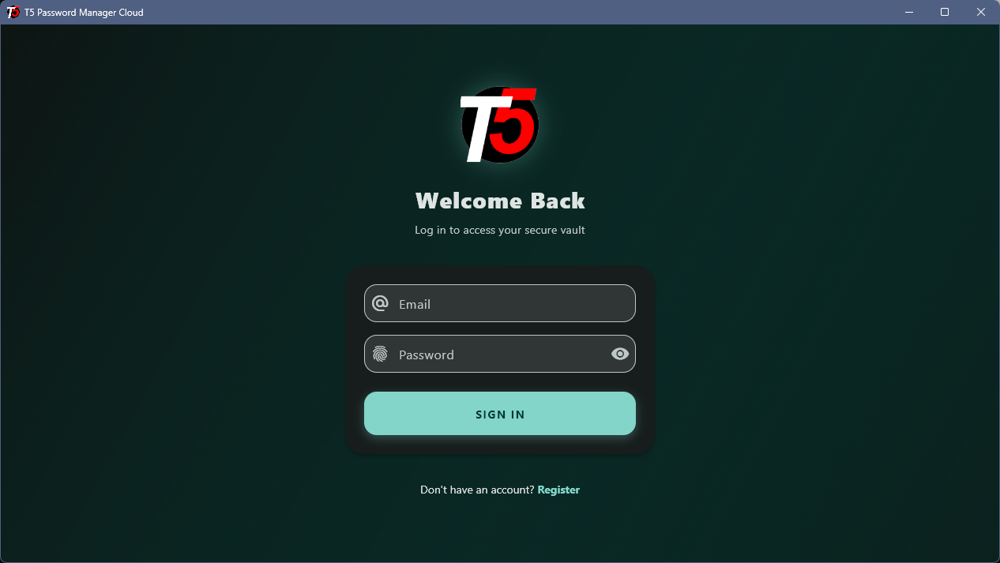
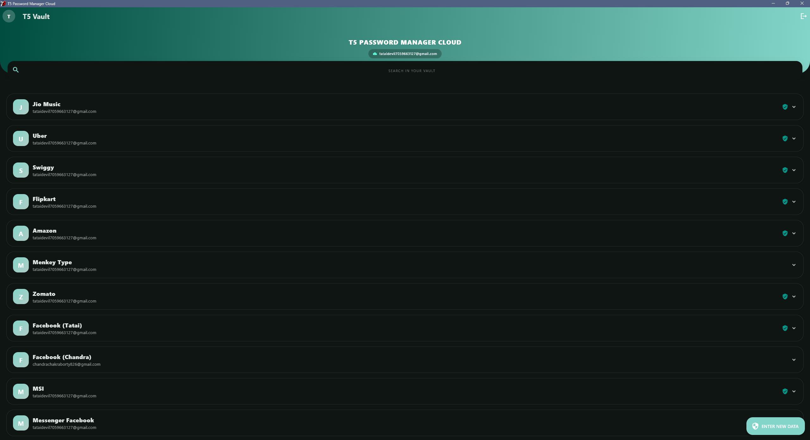
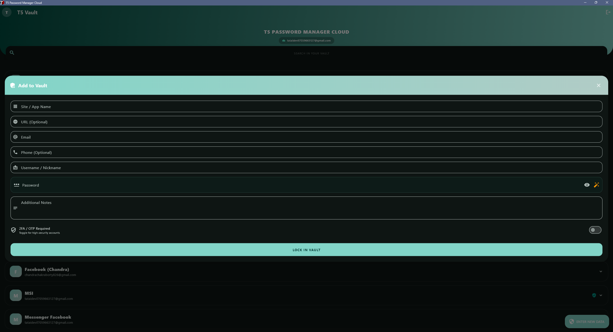
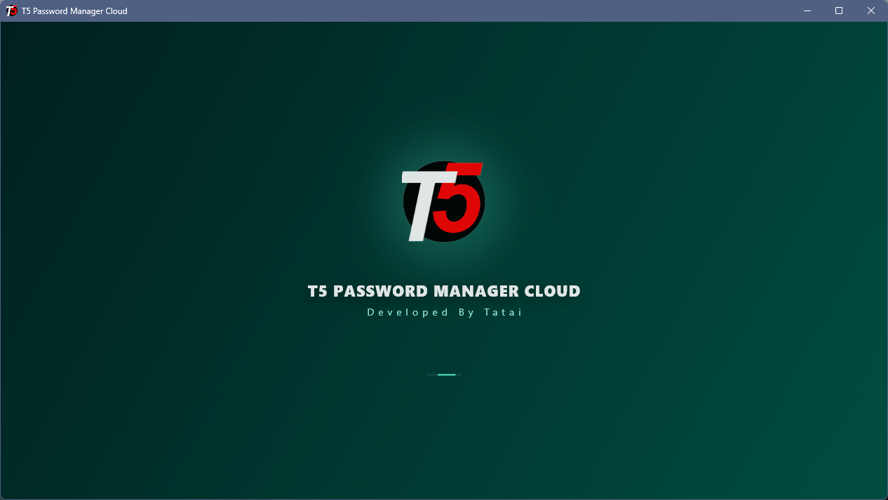
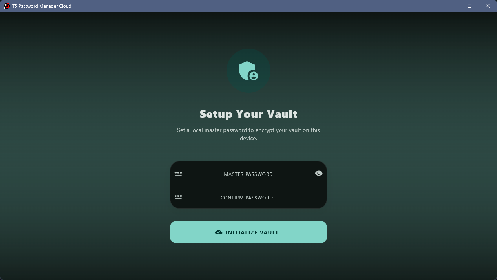
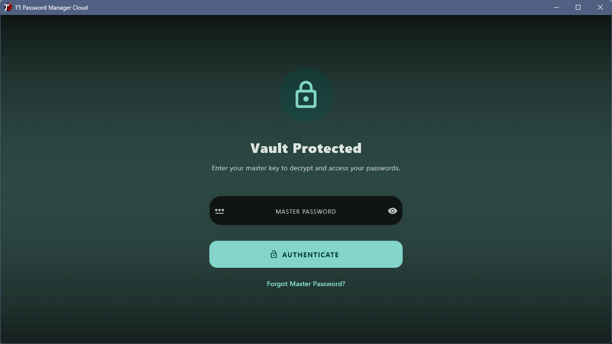
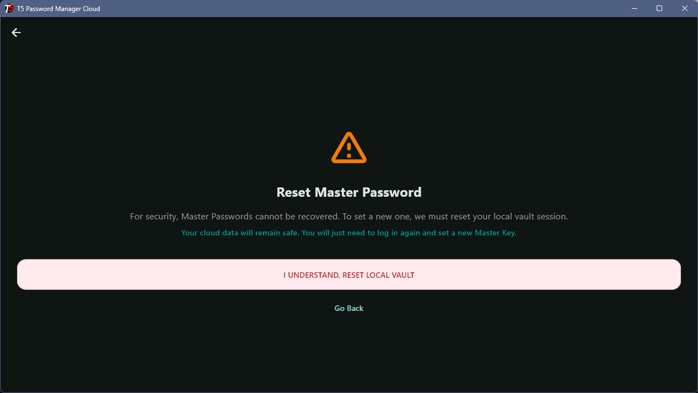
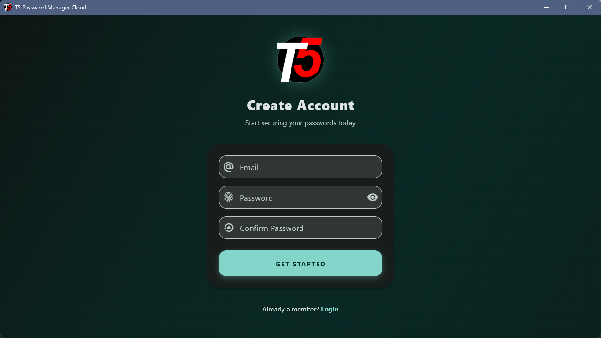

<div align="center">

  

  # T5 Password Manager - Windows 💻

  *Secure, lightweight, and intuitive credential management for your Windows desktop.*

  [](https://www.microsoft.com/windows)
  [](https://docs.flutter.dev/reference/supported-platforms)
  [](https://opensource.org/licenses/MIT)
  [](http://makeapullrequest.com)

  <br><br>

  <a href="https://github.com/Tatai47/T5-Password-Manager-Cloud-For-Windows/raw/refs/heads/main/T5%20Password%20Manager%20Cloud.exe">
    
  </a>

</div>

<br>

> **T5 Password Manager** is a packaged Windows desktop password manager for organizing credentials in vaults, generating passwords, and managing vault login and recovery workflows. This repository contains the Windows executable, screenshots, branding, and documentation.

---

## ✨ Features shown by the current package

- 🔐 Password-vault workflow with master-password login
- 🎲 Password-generation/data-entry screen
- 🗄️ Vault creation, login, reset, and password-entry screens
- 📴 Desktop-first workflow with local application screens
- ☁️ Repository branding describes the project as a cloud password manager; verify the published build's sync behavior before storing production credentials

> **Security note:** Do not rely on marketing claims such as “bank-grade encryption” or “fully safe” without reviewing the implementation and release process. The current repository does not include the application source code needed to independently verify encryption, cloud synchronization, or local storage behavior.

---

## 📸 Screenshots

| Login | Password Vault | Data Entry |
| :---: | :---: | :---: |
|  |  |  |

| Loading | Create Vault | Vault Login |
| :---: | :---: | :---: |
|  |  |  |

| Reset Vault | Sign Up |
| :---: | :---: |
|  |  |

---

## 📦 Download and install the packaged application

1. Download **[T5 Password Manager Cloud.exe](https://github.com/Tatai47/T5-Password-Manager-Cloud-For-Windows/raw/refs/heads/main/T5%20Password%20Manager%20Cloud.exe)**.
2. Save the executable to a folder such as `C:\Apps\T5PasswordManager`.
3. Start the application's Windows executable from that folder.
4. If Windows SmartScreen displays a warning, verify that the executable came from this repository before choosing whether to continue. Do not bypass warnings for copies obtained from unofficial mirrors.
5. Create or open a vault and test the application with non-critical data first.

The repository currently does not publish versioned GitHub Releases or a checksum for the executable. For security-sensitive software, a signed installer and SHA-256 checksum would improve release verification.

---

## 🪟 Windows compatibility

The table below separates **supported**, **not currently supported**, and **untested** configurations. It should not be read as a guarantee that every historical Windows version can run the packaged build.

| Windows version | Status | Notes |
|---|---|---|
| Windows 11, 64-bit | **Recommended / supported target** | Current Flutter Windows deployment documentation lists Windows 10 and 11 as supported targets. |
| Windows 10, 64-bit | **Recommended / supported target** | Keep Windows Update current and install the matching Microsoft Visual C++ runtime if the executable reports missing DLLs. |
| Windows 10/11 ARM64 | **Possible, unverified** | Requires an ARM64-compatible build or Windows compatibility support. This repository does not document an ARM64 build. |
| Windows 8/8.1 | **Unsupported by current Flutter deployment guidance** | No compatibility guarantee is provided. |
| Windows 7 | **Unsupported / not verified** | Current Flutter support lists Windows 8 and earlier as unsupported. Do not advertise Windows 7 compatibility unless a separately tested legacy build is provided. |

For the current packaged download, Windows 10 or Windows 11 64-bit should be treated as the minimum recommended environment.

---

## 🧩 Required Windows runtime components

These are **runtime components**, not hardware drivers. Most end users only need the packaged application and, if prompted, the Microsoft Visual C++ runtime. Do not install unrelated third-party driver packages to run this application.

### Microsoft Visual C++ Redistributable

Flutter Windows applications built with Microsoft C++ tooling may require the Microsoft Visual C++ runtime. Install the package that matches the application's architecture:

- [Visual C++ Redistributable x64](https://aka.ms/vc14/vc_redist.x64.exe) — normally appropriate for a 64-bit Windows build.
- [Visual C++ Redistributable x86](https://aka.ms/vc14/vc_redist.x86.exe) — only if the packaged executable is 32-bit or specifically asks for x86 DLLs.
- [Visual C++ Redistributable ARM64](https://aka.ms/vc14/vc_redist.arm64.exe) — for a native ARM64 build.
- [Microsoft's full Visual C++ Redistributable documentation](https://learn.microsoft.com/en-us/cpp/windows/latest-supported-vc-redist)

If Windows reports a missing file such as `VCRUNTIME140.dll` or `MSVCP140.dll`, install the appropriate official Microsoft package and restart the application. The runtime architecture must match the application architecture.

### No additional device drivers are documented

The repository does not identify a USB, smart-card, biometric, database, or other hardware driver dependency. If a future release needs one, document the exact driver name, version, architecture, vendor, and official download page here rather than linking to generic driver-download sites.

---

## 🛠 Development status and technology notes

The README previously described this project as Flutter/Dart with MVVM, Firebase/local encrypted storage, and Provider/Riverpod/GetX. Those details are not currently verifiable from the repository because no `pubspec.yaml`, `lib/`, `windows/`, or other Flutter source/build files are present in the current tree.

Based on the repository contents, the directly verifiable project artifacts are:

- `T5 Password Manager Cloud.exe` — packaged Windows executable
- `images/` — UI screenshots
- `T5-logo.png` — project logo
- `README.md` — project documentation

If the source is intended to be public, add the Flutter project files and pin the Flutter/Dart version so contributors can reproduce the build.

---

## 🧑‍💻 Building from source

A reproducible source build is not currently possible from this repository because the Flutter project files are not included. If the source is added later, the expected Windows development setup is:

- Flutter SDK on the stable channel
- Visual Studio (not Visual Studio Code) with the **Desktop development with C++** workload
- A current Windows 10 or Windows 11 development machine
- Git

Typical Flutter commands after the source tree and dependencies are available:

```powershell
flutter doctor -v
flutter pub get
flutter run -d windows
flutter build windows
```

See the official [Flutter Windows setup guide](https://docs.flutter.dev/platform-integration/windows/setup) for the development workload and validation steps.

---

## 🔒 Responsible use

- Use a unique master password and keep a secure recovery method.
- Test synchronization and recovery before storing important credentials.
- Do not commit vault files, credentials, Firebase configuration secrets, or API keys.
- Download binaries only from this repository or a future signed GitHub Release.
- Report suspected security issues privately to the maintainer instead of opening a public issue with sensitive details.

---

## 📄 License

The repository currently displays an MIT badge, but no `LICENSE` file is present in the top-level tree. Add the actual MIT license text to a `LICENSE` file if MIT licensing is intended.

---

## 🤝 Contributing

Issues and pull requests are welcome. Please include:

- Windows version and architecture
- Application/archive version or commit
- Exact steps to reproduce the problem
- Relevant error text or screenshots
- Whether the Microsoft Visual C++ Redistributable was installed
